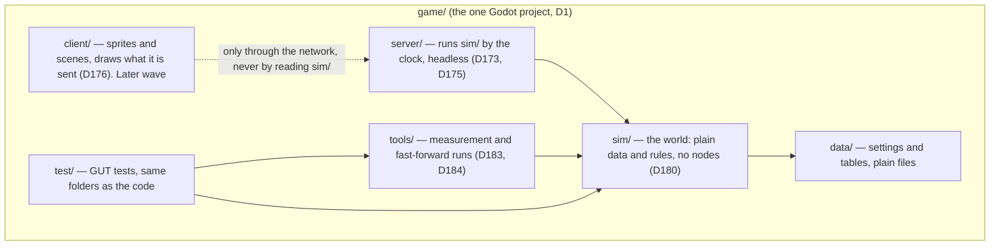

# Layout: where the code goes

**For:** telling every agent where a file belongs and which folder may depend on which.
**Catches:** scene nodes or client code leaking into the server's world (D180), a number written in code instead of data (D175), and two worktrees running two different Godot versions (D1).

## Folders
| Folder | What lives there | May use |
|---|---|---|
| `game/data/` | `settings.json` and later tables (backgrounds, items, roles). Timings in seconds. | nothing |
| `game/sim/` | The world and its rules: tiles, characters, movement, sight, NPC brain. | `data/` only |
| `game/server/` | The loop that steps `sim/` 10 times a second, and later the network and saving. | `sim/` |
| `game/tools/` | Headless runs that are not the game: the measurement, later the fast-forward test. | `sim/` |
| `game/client/` | Everything drawn. Not in wave 1. | what the server sends |
| `game/test/` | GUT tests. `test/sim/test_world.gd` tests `sim/world.gd`. | anything |
| `game/addons/gut/` | GUT 9.7.1, copied in and committed. Never edited. | — |
| `scripts/` | Repo tooling with short output: `verify.sh`, `godot.sh`, `measure.sh`, `plan.mjs`. | — |

## Rules for code in `game/sim/`
1. **No nodes.** Nothing extends `Node`, touches the scene tree, or uses physics (D180). Use `RefCounted` classes, arrays and dictionaries. Godot's `AStarGrid2D` is allowed: it needs no nodes.
2. **One character model.** A player's character and an NPC are the same data and follow the same rules. An NPC is a character with a brain attached (D4). No "players only" or "NPCs only" branch.
3. **Every number is a setting.** Speeds, distances, intervals and limits come from `game/data/`. Timings are written in seconds and turned into ticks when loaded (D175). A missing setting is an error, never a silent default.
4. **Stepped by hand.** The world moves only when `step()` is called. Nothing in `sim/` reads the clock, so tests and fast-forward runs need no waiting (D183).
5. **Same seed, same world.** All randomness comes from the world's own seeded generator, never the global one, and nothing depends on the order of a dictionary of objects. Two worlds from one seed stay equal tick after tick.
6. **Cost per tick stays flat.** Nothing compares every character with every other one. Characters are bucketed by area for sight (D179), and NPCs think in turns (D181).
7. **Reads only what a character knows.** A rule that decides for a character uses what that character sees and knows, never another character's true stats (D28, D176).

## Pinned versions (D1)
| What | Version | Where it comes from |
|---|---|---|
| Godot | 4.7.2-stable | `scripts/godot.sh` downloads it once into the per-user cache (`~/.cache/renown/godot/4.7.2-stable/` on Linux) and runs it. Every worktree shares that copy. The same binary is the editor. |
| GUT | 9.7.1 | Committed in `game/addons/gut/`. |

- Always run Godot through `scripts/godot.sh <args>`, never a system `godot`: a system update must not move the version.
- Headless: `scripts/godot.sh --headless --path game ...`.
- On Windows (desktop 2) there is no script yet: the UAT page of SIM-007 gives the steps by hand.

## Gaps found
- Windows and macOS have no `godot.sh` equivalent yet. Needed when a friend builds or hosts from one (D177). Not settled.
- How `client/` and `server/` share the message shapes is not designed. Belongs to the networking wave (D176).
- The format of the save files is left to the build (D182).
