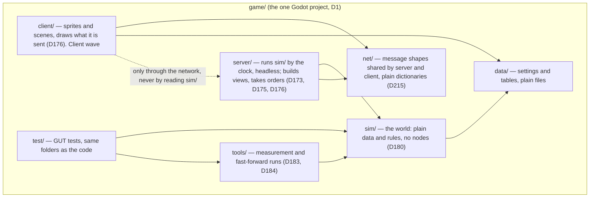

# Layout: where the code goes

**For:** telling every agent where a file belongs and which folder may depend on which.
**Catches:** scene nodes or client code leaking into the server's world (D180), a number written in code instead of data (D175), and two worktrees running two different Godot versions (D1).

## Folders
| Folder | What lives there | May use |
|---|---|---|
| `game/data/` | `settings.json` and later tables (backgrounds, items, roles). Timings in seconds. | nothing |
| `game/sim/` | The world and its rules: tiles, characters, movement, sight, NPC brain. | `data/` only |
| `game/net/` | The shapes of what goes over the network (hello, welcome, view, order, refusal) and the node that carries them as RPCs. Plain dictionaries, numbers and strings only (D215). | nothing |
| `game/server/` | The loop that steps `sim/` 10 times a second, what each client is sent (D176), the orders it takes, who is connected (D216). Later saving. | `sim/`, `net/` |
| `game/tools/` | Headless runs that are not the game: the measurement, later the fast-forward test. | `sim/` |
| `game/client/` | Everything drawn: the connect screen, the land, the characters. Art in `client/art/`. Never names a class from `sim/` or `server/`. | `net/`, and the drawing tables in `data/` |
| `game/test/` | GUT tests. `test/sim/test_world.gd` tests `sim/world.gd`. | anything |
| `game/addons/gut/` | GUT 9.7.1, copied in and committed. Never edited. | — |
| `scripts/` | Repo tooling with short output: `verify.sh`, `godot.sh`, `measure.sh`, `plan.mjs`. | — |

## Rules for code in `game/sim/`
1. **No nodes.** Nothing extends `Node`, touches the scene tree, or uses physics (D180). Use `RefCounted` classes, arrays and dictionaries. Godot's `AStarGrid2D` and `AStar2D` are allowed: they need no nodes. Which one paths on a map with walls on edges is picked by SIM-004 (D203).
2. **One character model.** A player's character and an NPC are the same data and follow the same rules. An NPC is a character with a brain attached (D4). No "players only" or "NPCs only" branch.
3. **Every number is a setting.** Speeds, distances, intervals and limits come from `game/data/`. Timings are written in seconds and turned into ticks when loaded (D175). A missing setting is an error, never a silent default.
4. **Stepped by hand.** The world moves only when `step()` is called. Nothing in `sim/` reads the clock, so tests and fast-forward runs need no waiting (D183).
5. **Same seed, same world.** All randomness comes from the world's own seeded generator, never the global one, and nothing depends on the order of a dictionary of objects. Two worlds from one seed stay equal tick after tick.
6. **Cost per tick stays flat.** Nothing compares every character with every other one. Characters are bucketed by area for sight (D179), and NPCs think in turns (D181).
   - **A path search never floods the map (D187).** Free tiles carry the number of their connected area, labelled when the map is made. A walk to a blocked tile or to another area is refused with no search. One such search took 50 to 85 ms in a probe: most of a tick.
7. **Reads only what a character knows.** A rule that decides for a character uses what that character sees and knows, never another character's true stats (D28, D176).

## Pinned versions (D1)
| What | Version | Where it comes from |
|---|---|---|
| Godot | 4.7.2-stable | `scripts/godot.sh` downloads it once into the per-user cache (`~/.cache/renown/godot/4.7.2-stable/` on Linux) and runs it. Every worktree shares that copy. The same binary is the editor. |
| GUT | 9.7.1 | Committed in `game/addons/gut/`. |

- Always run Godot through `scripts/godot.sh <args>`, never a system `godot`: a system update must not move the version.
- Headless: `scripts/godot.sh --headless --path game ...`.
- On Windows (desktop 2) there is no script yet: the UAT page of SIM-007 gives the steps by hand.

## Checked with the pinned versions (2026-11-14, Linux, headless)
Run by hand in a throwaway project, so OPS-001 doesn't have to guess. All of it worked as written.

- **Godot download:** `https://github.com/godotengine/godot/releases/download/4.7.2-stable/Godot_v4.7.2-stable_linux.x86_64.zip` (78 MB, one binary inside, `--version` prints `4.7.2.stable.official`). The Windows one is `Godot_v4.7.2-stable_win64.exe.zip` in the same release (the link answers; not run).
- **GUT:** the `addons/gut` folder of `https://github.com/bitwes/Gut` at tag `v9.7.1`, enabled in `project.godot` under `[editor_plugins]`.
- **First run of a checkout:** `godot --headless --path game --import` (exit 0). It builds the git-ignored `game/.godot/` cache.
- **Tests:** `godot --headless --path game -d -s addons/gut/gut_cmdln.gd -gdir=res://test -gexit`. Exit 0 when all pass, 1 when one fails.
- **A failing test prints its file and its line on separate lines** (`res://test/test_x.gd`, then `[Failed]: ...`, then `at line 4`). `verify.sh` has to keep those lines together.
- **A parse error in a script that no test loads is NOT caught** by `--import` or by GUT: both exit 0. `godot --headless --path game --check-only -s <file>` exits 1 and prints `Parse Error`. `verify.sh` needs a step that runs it on every `.gd` file under `game/` outside `addons/`.
- **Godot writes a `.gd.uid` file beside every script.** Commit it with the script; it counts as part of the same file for a task's `touches`.
- **`AStarGrid2D` works with no node and no scene:** `region`, `update()`, `set_point_solid()`, `get_id_path()`. `DIAGONAL_MODE_ONLY_IF_NO_OBSTACLES` gives the both-sides-free diagonal rule of D204 for whole tiles. It can't block an edge between tiles (D203): SIM-004 compares `AStar2D` and a double-resolution `AStarGrid2D` for that.

## Gaps found
- Windows has no `godot.sh` equivalent yet (`scripts/godot.sh` ran on macOS on 2026-11-15). Needed when a friend builds or hosts from one (D177). Not settled.
- How `client/` and `server/` share the message shapes: settled, `game/net/` (D215).
- The format of the save files is left to the build (D182).
