# Task graph

Generated by `scripts/plan.mjs graph` — do not edit by hand.

Legend: green = done, blue = in progress, teal = qa, purple = code review, pink = pr open, yellow = ready, gray = blocked, red = needs human, red edges = critical path.

```mermaid
flowchart LR
  OPS_001["OPS-001<br/>Add the Godot project in game/ with GUT, checked by scripts/verify.sh"]:::done
  OPS_002["OPS-002<br/>Prove the verify-on-stop hook blocks a failing implementer"]:::done
  SIM_001["SIM-001<br/>Load settings from data, with timings in seconds turned into ticks"]:::done
  SIM_002["SIM-002<br/>Hold the world as plain data, a tile grid with characters on it"]:::done
  SIM_003["SIM-003<br/>Step the world in fixed ticks, by the clock or by hand"]:::done
  SIM_004["SIM-004<br/>Walk characters along a path on the grid in 8 directions"]:::done
  SIM_005["SIM-005<br/>Work out who a character has in sight, by distance with no wall between"]:::done
  SIM_006["SIM-006<br/>Give NPCs a stand-in brain that thinks once a second, in turns"]:::done
  SIM_007["SIM-007<br/>Measure the tick time for N NPCs on a headless server"]:::done
  PRO_001["PRO-001<br/>Unpack only the test game's art into a Godot project in prototype/"]:::done
  PRO_002["PRO-002<br/>Draw a seeded patch with one building, a door and trees, each in the right order"]:::done
  PRO_003["PRO-003<br/>Show a stacked, tinted Creator human walking in 8 directions beside an orc and a goblin"]:::done
  PRO_004["PRO-004<br/>Play the five block candidates side by side with a sword and shield"]:::done
  PRO_005["PRO-005<br/>Click the ground to walk the human there along a path at 3.3 tiles a second"]:::done
  PRO_006["PRO-006<br/>Click the dummy to start an auto-attack fight that lasts about 30 seconds"]:::done
  PRO_007["PRO-007<br/>Record the test game's lessons as decisions, then wave 1 continues"]:::done
  SIM_008["SIM-008<br/>Step movement, sight and the NPC brains from one step of the world"]:::done
  SIM_009["SIM-009<br/>Give every character a look as data, its race and what it wears"]:::done
  SIM_010["SIM-010<br/>Build the stand-in world the server starts with, one building, trees, rocks and 32 wandering NPCs"]:::done
  SIM_011["SIM-011<br/>Use a door from a tile beside it, and open one by walking through"]:::done
  NET_001["NET-001<br/>Work out what one character is sent, the land once and then each tick who and which doors it has in sight"]:::done
  NET_002["NET-002<br/>Accept clients over ENet and give each one a character at the waking spot"]:::done
  NET_003["NET-003<br/>Carry out a client's walk and door orders on its own character only"]:::done
  NET_004["NET-004<br/>Keep a leaver's character for 30 seconds and give it back when the player returns"]:::done
  CLI_001["CLI-001<br/>Connect from a screen with an address field and hold what the server sends"]:::done
  CLI_002["CLI-002<br/>Draw the land around your character in the right order, with the inside of the building you are in"]:::done
  CLI_003["CLI-003<br/>Draw each character as stacked, tinted Creator parts at its race's size, sliding from tile to tile"]:::done
  CLI_004["CLI-004<br/>Click the ground to walk and a door to use it, with the camera on your character"]:::done
  CLI_006["CLI-006<br/>Move the code-made art still under prototype/art/made to game/client/art/made, with every art script pointing there"]:::ready
  HUM_001["HUM-001<br/>Point the two art skills at game/client/art instead of prototype"]:::needs_human
  NET_005["NET-005<br/>Prove that two players each see the other only while in sight, and ship the start scripts with the test page"]:::blocked
  SIM_012["SIM-012<br/>The world hands out character ids, so no two characters ever share one"]:::ready
  SIM_013["SIM-013<br/>A world that has walked or thought is freed once nothing holds it"]:::ready
  CLI_007["CLI-007<br/>The Skills screen moves the way the agreed page does"]:::blocked
  CLI_008["CLI-008<br/>The body's loot window drawn in Godot from body.json"]:::ready
  CLI_009["CLI-009<br/>The game opens on the main menu, with working Join game and Settings panels"]:::blocked
  OPS_001 --> OPS_002
  OPS_002 --> SIM_001
  PRO_007 --> SIM_001
  OPS_002 --> SIM_002
  PRO_007 --> SIM_002
  SIM_001 --> SIM_003
  SIM_002 --> SIM_003
  SIM_003 --> SIM_004
  SIM_001 --> SIM_005
  SIM_002 --> SIM_005
  SIM_004 --> SIM_006
  SIM_005 --> SIM_006
  SIM_006 --> SIM_007
  OPS_001 --> PRO_001
  PRO_001 --> PRO_002
  PRO_001 --> PRO_003
  PRO_003 --> PRO_004
  PRO_002 --> PRO_005
  PRO_003 --> PRO_005
  PRO_004 --> PRO_006
  PRO_005 --> PRO_006
  PRO_006 --> PRO_007
  SIM_007 --> SIM_008
  SIM_002 --> SIM_009
  SIM_008 --> SIM_010
  SIM_009 --> SIM_010
  SIM_008 --> SIM_011
  SIM_010 --> NET_001
  SIM_011 --> NET_001
  NET_001 --> NET_002
  NET_002 --> NET_003
  NET_003 --> NET_004
  NET_002 --> CLI_001
  CLI_001 --> CLI_002
  CLI_001 --> CLI_003
  NET_003 --> CLI_004
  CLI_002 --> CLI_004
  CLI_003 --> CLI_004
  CLI_002 --> CLI_006
  CLI_003 --> CLI_006
  CLI_006 --> HUM_001
  NET_004 --> NET_005
  CLI_004 --> NET_005
  HUM_001 --> NET_005
  CLI_006 --> CLI_007
  NET_005 --> CLI_009
  CLI_007 --> CLI_009
  classDef done fill:#d1fae5,stroke:#059669,color:#064e3b
  classDef in_progress fill:#dbeafe,stroke:#2563eb,color:#1e3a8a
  classDef qa fill:#ccfbf1,stroke:#0d9488,color:#134e4a
  classDef code_review fill:#ede9fe,stroke:#7c3aed,color:#4c1d95
  classDef pr_open fill:#fce7f3,stroke:#db2777,color:#831843
  classDef ready fill:#fef3c7,stroke:#d97706,color:#78350f
  classDef blocked fill:#f3f4f6,stroke:#9ca3af,color:#4b5563
  classDef needs_human fill:#fee2e2,stroke:#dc2626,color:#7f1d1d
  linkStyle 40,43,45 stroke:#dc2626,stroke-width:3px
```

